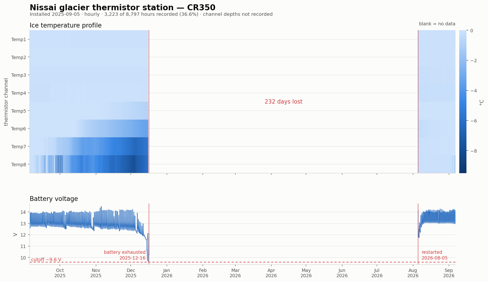

# Glacier station — CR350 thermistor string

Campbell CR350 (`CR300Series`), serial 11074. Eight thermistors plus battery and
panel temperature. Downloaded 2026-09-06.

| table | records | period | contents |
|---|---|---|---|
| `Table1` | 3,235 | 2025-08-18 → 2026-09-06 | hourly averages, all channels |
| `Table2` | 135 | 2025-09-05 → 2026-09-06 | daily minimum battery |
| `Public` / `Status` / `DataTableInfo` | 1 each | 2026-09-06 | download-time snapshots |

## Deployed 2025-09-05

Every channel reads ~29 °C on 2025-08-18 (in storage), then drops to ~0 °C on
2025-09-05. 2025-09-04 is the installation day, with mixed values.

## 232-day outage — battery exhaustion

**The record is only 35.1 % complete.** The logger stopped at 2025-12-16 17:00
and did not resume until 2026-08-05 11:00, losing the entire winter and spring —
the season of most interest for a thermistor string.

The cause is unambiguous. Daily minimum battery voltage:

| date | V |
|---|---|
| 2025-11-25 | 12.45 |
| 2025-12-05 | 12.23 |
| 2025-12-13 | 11.63 |
| 2025-12-14 | 10.57 |
| 2025-12-15 | 9.74 |
| 2025-12-16 | **9.63** → stops |

A steady three-week decline with partial daytime recovery (12.08 V at midday on
the 16th, collapsing again by evening): the panel is still generating a little
but no longer keeping up. Consistent with snow cover or shading at midwinter sun
angles, draining the battery to the CR350's cutoff.

On restart in August 2026 the battery recovered immediately to 13–14 V and has
held since, so the battery and panel are both serviceable — this is a winter
energy-budget failure, not failed hardware.

**Before next winter**: panel angle and orientation against snow accumulation,
battery capacity sized for the dark months, and ideally a low-voltage telemetry
alert — a three-week decline is plenty of warning if anyone can see it.

`../../reports/nissai_glacier_2026.png`, from
`scripts/plot_glacier.py`.

## Temperature profile

The surviving data is physically sound and shows a clean englacial profile:

| channel | mean | min |
|---|---|---|
| Temp1–4 | −0.07 °C | −0.24 |
| Temp5 | −0.08 | −0.96 |
| Temp6 | −0.84 | −3.42 |
| Temp7 | −2.38 | −6.40 |
| Temp8 | −3.13 | −9.09 |

Temp1–4 sit at the pressure-melting point — temperate ice — with a monotonic
gradient to Temp8, which carries the seasonal signal and is therefore nearest
the surface.

**Channel depths are not recorded anywhere in this repo.** Without them the
profile cannot be interpreted quantitatively. Needs adding from the field notes.
