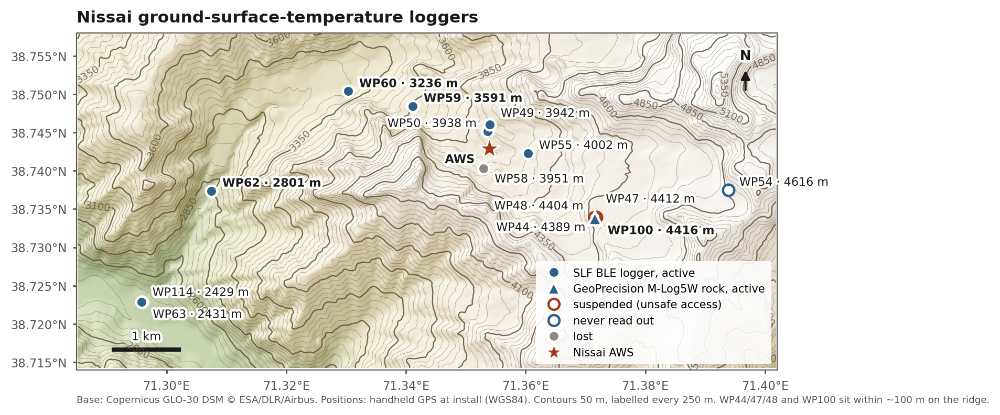

# Ground surface temperature — Sangvor

## Loggers

Positions are handheld GPS (WGS84) at installation, from
[`BLE_sangvor_loggers.csv`](https://github.com/joelfiddes/TajGST/blob/main/data/metadata/BLE_sangvor_loggers.csv);
`field/2026/sites.py` holds the same values. The **Data** links point to each
download file in the public [TajGST](https://github.com/joelfiddes/TajGST) repo,
labelled by download date. Each file holds the full record up to that download.

| WP | Logger | Lon (°E) | Lat (°N) | Elev (m) | Installed | Status | Data |
|---|---|---|---|---|---|---|---|
| **WP100** | GeoPrecision M-Log5W Rock `A542D3` | 71.371561 | 38.733798 | 4416 | 2022-09-07 | active | [2022-09](https://github.com/joelfiddes/TajGST/blob/main/data/fanmountains/A542D3/raw/A542D3_20220907044045.csv) · [2023-09](https://github.com/joelfiddes/TajGST/blob/main/data/fanmountains/A542D3/raw/A542D3_20230921094905.csv) · [2024-09](https://github.com/joelfiddes/TajGST/blob/main/data/fanmountains/A542D3/raw/A542D3_20240904063615.csv) · [2025-09](https://github.com/joelfiddes/TajGST/blob/main/data/fanmountains/A542D3/raw/A542D3_20250904061251.csv) · [2025-09](https://github.com/joelfiddes/TajGST/blob/main/data/fanmountains/A542D3/raw/A542D3_20250904061400.csv) |
| **WP114** | SLF BLE `2005-0092` | 71.295810 | 38.722870 | 2429 | 2023-09-22 | active | [2023-06](https://github.com/joelfiddes/TajGST/blob/main/data/sangvor/2005-0092_20230626_0550_offset.csv) · [2023-09](https://github.com/joelfiddes/TajGST/blob/main/data/sangvor/2005-0092_20230922_1236.csv) |
| **WP62** | SLF BLE `2005-0091` | 71.307500 | 38.737387 | 2801 | 2021-09-25 | active | [2021-09](https://github.com/joelfiddes/TajGST/blob/main/data/sangvor/2005-0091_20210925_0513.csv) · [2022-09](https://github.com/joelfiddes/TajGST/blob/main/data/sangvor/2005-0091_20220905_1301.csv) · [2023-06](https://github.com/joelfiddes/TajGST/blob/main/data/sangvor/2005-0091_20230626_0408_offset.csv) · [2023-09](https://github.com/joelfiddes/TajGST/blob/main/data/sangvor/2005-0091_20230922_1135.csv) |
| **WP60** | SLF BLE `2005-0081` | 71.330360 | 38.750384 | 3236 | 2021-09-25 | active | [2021-09](https://github.com/joelfiddes/TajGST/blob/main/data/sangvor/2005-0081_20210925_0247.csv) · [2022-09](https://github.com/joelfiddes/TajGST/blob/main/data/sangvor/2005-0081_20220906_0845.csv) · [2023-06](https://github.com/joelfiddes/TajGST/blob/main/data/sangvor/2005-0081_20230626_0106_offset.csv) · [2023-09](https://github.com/joelfiddes/TajGST/blob/main/data/sangvor/2005-0081_20230922_0933.csv) |
| **WP59** | SLF BLE `2005-0070` | 71.341133 | 38.748462 | 3591 | 2021-09-24 | active | [2021-09](https://github.com/joelfiddes/TajGST/blob/main/data/sangvor/2005-0070_20210924_1341.csv) · [2022-09](https://github.com/joelfiddes/TajGST/blob/main/data/sangvor/2005-0070_20220907_0332.csv) · [2023-06](https://github.com/joelfiddes/TajGST/blob/main/data/sangvor/2005-0070_20230625_0507_offset.csv) · [2023-09](https://github.com/joelfiddes/TajGST/blob/main/data/sangvor/2005-0070_20230922_0717.csv) |
| **WP50** | SLF BLE `2005-0071` | 71.353654 | 38.745178 | 3938 | 2021-09-23 | active | [2021-09](https://github.com/joelfiddes/TajGST/blob/main/data/sangvor/2005-0071_20210923_1414.csv) · [2022-09](https://github.com/joelfiddes/TajGST/blob/main/data/sangvor/2005-0071_20220908_0533.csv) · [2023-06](https://github.com/joelfiddes/TajGST/blob/main/data/sangvor/2005-0071_20230625_0100_offset.csv) · [2023-09](https://github.com/joelfiddes/TajGST/blob/main/data/sangvor/2005-0071_20230922_0334.csv) |
| **WP49** | SLF BLE `2005-0077` | 71.354001 | 38.746032 | 3942 | 2021-09-23 | active | [2021-09](https://github.com/joelfiddes/TajGST/blob/main/data/sangvor/2005-0077_20210923_1403.csv) · [2022-09](https://github.com/joelfiddes/TajGST/blob/main/data/sangvor/2005-0077_20220908_0546.csv) · [2023-06](https://github.com/joelfiddes/TajGST/blob/main/data/sangvor/2005-0077_20230625_0114_offset.csv) · [2023-09](https://github.com/joelfiddes/TajGST/blob/main/data/sangvor/2005-0077_20230922_0400.csv) |
| **WP55** | SLF BLE `2005-0080` | 71.360396 | 38.742309 | 4002 | 2021-09-24 | active | [2021-09](https://github.com/joelfiddes/TajGST/blob/main/data/sangvor/2005-0080_20210924_0938.csv) · [2022-09](https://github.com/joelfiddes/TajGST/blob/main/data/sangvor/2005-0080_20220908_0620.csv) · [2023-06](https://github.com/joelfiddes/TajGST/blob/main/data/sangvor/2005-0080_20230624_0829_offset.csv) · [2023-09](https://github.com/joelfiddes/TajGST/blob/main/data/sangvor/2005-0080_20230921_1457.csv) |
| **WP54** | SLF BLE `2005-0085` | 71.393875 | 38.737510 | 4616 | 2021-09-24 | never read out | — |
| **WP44** | SLF BLE `2005-0086` | 71.371821 | 38.733970 | 4389 | 2021-09-23 | suspended (unsafe slope) | [2021-09](https://github.com/joelfiddes/TajGST/blob/main/data/sangvor/2005-0086_20210923_0646.csv) |
| **WP47** | SLF BLE `2005-0082` | 71.371571 | 38.733873 | 4412 | 2021-09-23 | suspended (unsafe slope) | [2021-09](https://github.com/joelfiddes/TajGST/blob/main/data/sangvor/2005-0082_20210923_0725.csv) · [2022-09](https://github.com/joelfiddes/TajGST/blob/main/data/sangvor/2005-0082_20220907_0945.csv) · [2023-09](https://github.com/joelfiddes/TajGST/blob/main/data/sangvor/2005-0082_20230921_1119.csv) |
| **WP48** | SLF BLE `2005-0074` | 71.371490 | 38.733920 | 4404 | 2022-09-07 | suspended (unsafe slope) | [2022-09](https://github.com/joelfiddes/TajGST/blob/main/data/sangvor/2005-0074_20220907_1001.csv) · [2023-09](https://github.com/joelfiddes/TajGST/blob/main/data/sangvor/2005-0074_20230921_1138.csv) |
| **WP58** | SLF BLE `2005-0076` | 71.352994 | 38.740310 | 3951 | 2021-09-24 | lost | [2021-09](https://github.com/joelfiddes/TajGST/blob/main/data/sangvor/2005-0076_20210924_1126.csv) · [2022-09](https://github.com/joelfiddes/TajGST/blob/main/data/sangvor/2005-0076_20220908_0725.csv) |
| **WP63** | SLF BLE `2005-0079` | 71.295889 | 38.722846 | 2431 | 2021-09-25 | lost | [2021-09](https://github.com/joelfiddes/TajGST/blob/main/data/sangvor/2005-0079_20210925_0617.csv) |

- **WP100** records every 6 hours; trim its series to start on 2022-09-07. Its
  site is bedrock, aspect N, slope 35°.
- **BLE loggers**: the most recent download in TajGST is September 2023.
- **WP100's September 2026 download** is on the TajGST branch
  `data/gst-2026-wp100`, which is not merged or pushed yet, so the links above
  stop at 2025-09.
- **WP114** replaced WP63 in September 2023, 10 m to the NW, after WP63 was lost
  to a ploughed field.

The map comes from `scripts/plot_site_maps.py`.

## Where the data lives

GST data is **not stored here yet**. It lives in the `TajGST` repo:

- `data/fanmountains/A542D3/` — WP100, the deployed Sangvor logger
- `data/fanmountains/A542D1`, `A542D2`, `A542D4` — pre-deployment storage only
- `data/sangvor/` — the older `2005-00XX` BLE logger series
- `data/metadata/BLE_sangvor_loggers.csv` — site metadata incl. WP100

## Why it has not moved

`TajGST/scripts/plot_ground_temperature.py` picks its file-format parser by
testing whether the path contains `"sangvor"`. That branch expects the older
`2005-00XX` format; the `A542Dx` loggers are GeoPrecision FG2, matching the
`fanmountains` branch. In a repo *called* sangvor every path matches, so every
FG2 file would be silently mis-parsed.

**Fix the parser to sniff the file header rather than the path, then migrate.**

## What to know about the A542Dx loggers

- **Only A542D3 has a field record**, from 2022-09-07 at WP100 (4416 m, rock).
  Trim to that date — the preceding ~14 months are office storage and will bias
  MAGST and freezing-index badly.
- **A542D1, D2 and D4 read office temperatures** (18–31 °C year-round, tracking
  one another to 0.1 °C) for their whole 2021–2026 record. D1 and D2 were
  deployed at Sangvor in September 2026, so their field records begin with the
  *next* download; nothing collected so far belongs in a GST analysis.
- **Sampling is 6-hourly**, despite file headers declaring `PERIOD: 3600 sec`.
- New sites deployed in 2026 still need waypoints and coordinates adding to
  `BLE_sangvor_loggers.csv`.
